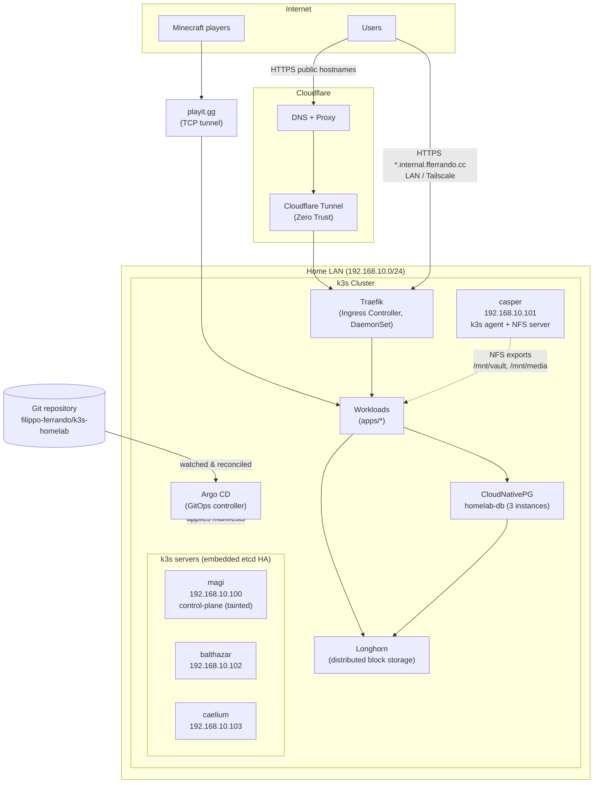
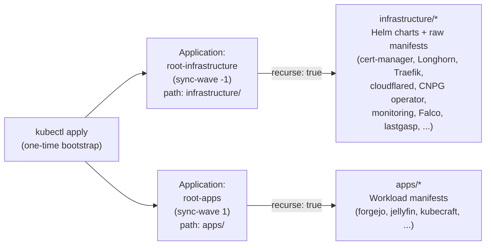
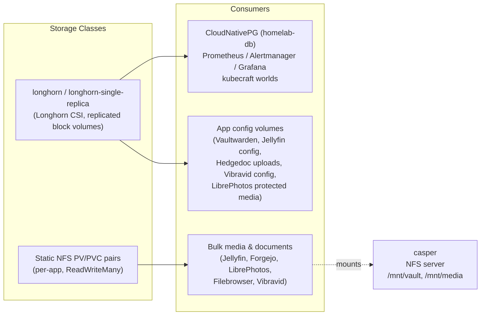
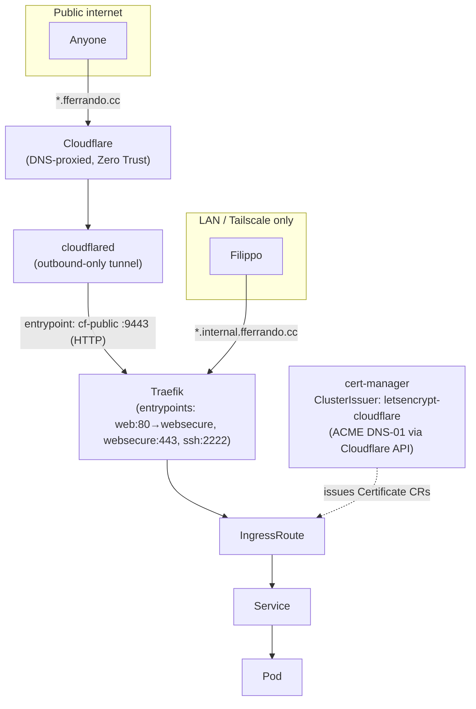
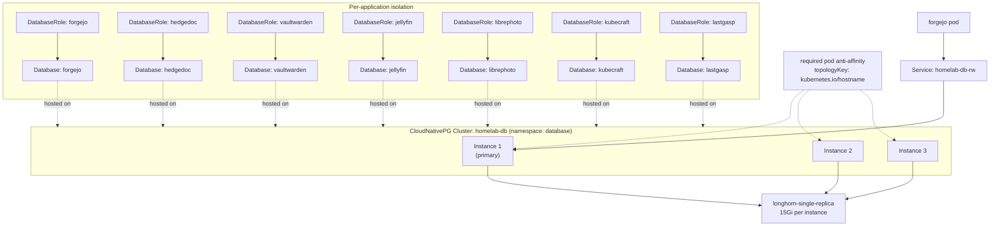
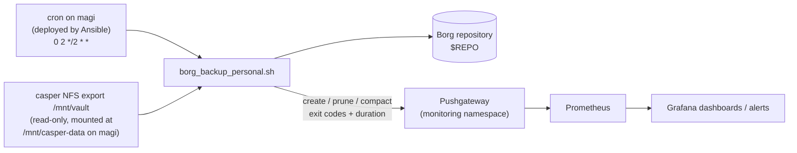

# k3s-homelab

A self-hosted, GitOps-driven Kubernetes homelab. The entire cluster, from bare-metal OS prep to running applications, is defined as code and reconciled continuously by Argo CD. Nothing is deployed by hand: Ansible provisions the hosts and bootstraps the cluster once, then Git becomes the single source of truth.

Every folder under `apps/` and `infrastructure/` has its own `README.md` describing each file. Major changes and the reasons behind them are in [`CHANGELOG.md`](CHANGELOG.md).

## At a glance

| | |
|---|---|
| **Orchestration** | k3s (embedded etcd, 3-server HA control plane, SELinux enabled) |
| **GitOps engine** | Argo CD (app-of-apps pattern) |
| **Ingress** | Traefik (DaemonSet) + Cloudflare Tunnel |
| **TLS** | cert-manager + Let's Encrypt (Cloudflare DNS-01) |
| **Storage** | Longhorn (distributed block) + NFS (bulk media/data) |
| **Database** | CloudNativePG (HA Postgres, 3 instances) |
| **Secrets** | Bitnami Sealed Secrets |
| **Security** | NetworkPolicies (ingress + egress) on every namespace, Pod Security Admission, Falco runtime detection |
| **Observability** | kube-prometheus-stack (Prometheus, Grafana, Alertmanager) + Pushgateway + lastgasp (node kernel logs) |
| **Maintenance** | Kured (reboot orchestration) + descheduler + Ansible patch playbooks + Renovate |
| **Backups** | Borg on the host, metrics pushed to Prometheus via Pushgateway |
| **Provisioning** | Ansible (OS prep, k3s bootstrap, NFS, backup jobs) |

---

## Architecture overview



### Node roles

| Host | IP | k3s role | Notes |
|---|---|---|---|
| `magi` | `192.168.10.100` | server (cluster-init) | Control plane, tainted `NoSchedule`: runs only control-plane and tolerating system pods (Kured, Falco, device plugin). Also runs the Borg backup cron. |
| `balthazar` | `192.168.10.102` | server | Also schedulable compute node |
| `caelium` | `192.168.10.103` | server | Also schedulable compute node |
| `casper` | `192.168.10.101` | agent | NFS server (`/mnt/vault`, `/mnt/media`), no control-plane role |

k3s runs with embedded etcd across all three servers (`--cluster-init`), `--selinux`, `nftables` kube-proxy mode, and the bundled Traefik disabled in favor of the Helm-managed Traefik deployed through Argo CD. Every node is also joined to a Tailscale tailnet for out-of-band SSH access.

---

## GitOps model: app-of-apps

Everything under `infrastructure/` and `apps/` is managed by two root Argo CD `Application` resources defined in [`system/root-app.yaml`](system/root-app.yaml):



Both roots use `directory.recurse: true`, so **any** manifest added under `infrastructure/` or `apps/` is picked up automatically, with no per-app Argo CD `Application` to register by hand. Helm-based components are themselves `Application` manifests inside those folders (multi-source, with `values.yaml` read from this repo). Both roots sync with `automated: {prune: true, selfHeal: true}`: drift is corrected automatically, and deleting a manifest from Git deletes the resource from the cluster.

### Sync-wave ordering

Deployment order is controlled through `argocd.argoproj.io/sync-wave` annotations, since dependencies (CRDs, storage classes, secrets, databases) must exist before the things that consume them:

| Wave | Components |
|---|---|
| `-5` | Argo CD itself (`argocd` Application) |
| `-4` | Sealed Secrets, Longhorn |
| `-3` | cert-manager, CloudNativePG operator, Traefik, every `Namespace` |
| `-2` | Kured, generic-device-plugin |
| `-1` | `root-infrastructure`, kube-prometheus-stack, descheduler, `longhorn-single-replica` StorageClass, core sealed secrets (Cloudflare token, tunnel token, Longhorn auth) |
| `0` | cloudflared, app PVCs/PVs, app sealed DB credentials |
| `1` | `root-apps`, cert-manager `ClusterIssuer`, Pushgateway, Falco |
| `2` | `Certificate`s, infra IngressRoutes and middlewares, CNPG `Cluster` (`homelab-db`) |
| `3`, `4` | Per-app CNPG `DatabaseRole` / `Database` objects |
| `5` | App Deployments and Services, lastgasp and kubecraft Applications |
| `6` | App `IngressRoute`s and middlewares |

This produces a **two-phase boot**: on a brand-new cluster, `cloudflared` and `cert-manager` show errors until their sealed secrets are created and pushed. This is expected and self-heals (see [Bootstrapping](#bootstrapping-a-new-cluster)).

---

## Repository structure

```
k3s-homelab/
├── system/
│   └── root-app.yaml             # The two app-of-apps Argo CD Applications
├── infrastructure/               # Cluster-wide platform services (one folder per component)
│   ├── sealed-secrets/
│   ├── longhorn/
│   ├── cert-manager/
│   ├── cloudnative-pg/           # CNPG operator only; the actual DB lives in apps/database
│   ├── traefik/
│   ├── cloudflared/
│   ├── kured/
│   ├── descheduler/
│   ├── kube-prometheus-stack/    # also Grafana dashboards and the public status page
│   ├── pushgateway/
│   ├── falco/
│   ├── lastgasp/
│   ├── generic-device-plugin/    # exposes /dev/kmsg to the lastgasp agents
│   └── argocd/                   # Argo CD itself (Helm, self-managed) + ingress
├── apps/                         # Workloads, one folder per application/namespace
│   ├── database/                 # Shared CloudNativePG Postgres cluster
│   ├── forgejo/
│   ├── jellyfin/
│   ├── vaultwarden/
│   ├── librephoto/
│   ├── hedgedoc/
│   ├── filebrowser_quantum/
│   ├── vibravid/
│   ├── kubecraft/
│   └── portfolio/
├── ansible/                      # Bare-metal provisioning & day-2 host operations
│   ├── 01_os_prep.yml
│   ├── 02_bootstrap_cluster.yml
│   ├── 03_deploy_borg_backups.yml
│   ├── 04_deploy_nfs_shares.yml
│   ├── patch_cluster.yml
│   ├── prune_cached_images.yml
│   ├── inventory.ini
│   ├── group_vars/all.yml
│   └── scripts/                  # Borg backup script pushed to magi
├── notes/                        # kubectl wiki, guides, security audits (see notes/README.md)
├── CHANGELOG.md                  # Major changes and why they were made
└── renovate.json                 # Automated dependency updates (Helm charts + container images)
```

App folders share a convention: `namespace.yaml`, `deployment.yaml`, `service.yaml`, `ingressroute.yaml`, `networkpolicy.yaml`, plus storage, certificate, database and sealed-secret manifests as needed. Infra folders are either a thin `Application` wrapper around an upstream Helm chart (with a companion `values.yaml`) or raw manifests for things with no chart.

---

## Infrastructure stack

| Component | Purpose | Source | Namespace |
|---|---|---|---|
| **Sealed Secrets** | Encrypts secrets so they're safe to commit to Git | `bitnami.github.io/sealed-secrets` | `kube-system` |
| **Longhorn** | Distributed block storage / CSI, snapshots, UI | `charts.longhorn.io` | `longhorn-system` |
| **cert-manager** | Automated TLS certs via ACME | `charts.jetstack.io` | `cert-manager` |
| **CloudNativePG** | Postgres operator (HA clusters, failover, declarative roles/databases) | `cloudnative-pg.github.io/charts` | `cnpg-system` |
| **Traefik** | Ingress controller (DaemonSet), dashboard, metrics | `traefik.github.io/charts` | `traefik` |
| **cloudflared** | Cloudflare Tunnel client: exposes public services without opening inbound ports | raw manifest | `cloudflared` |
| **Kured** | Coordinated node reboots after OS patching | `kubereboot.github.io/charts` | `kube-system` |
| **descheduler** | Rebalances pods (duplicates, anti-affinity, utilization) via CronJob | `kubernetes-sigs.github.io/descheduler` | `kube-system` |
| **kube-prometheus-stack** | Prometheus, Grafana, Alertmanager, node-exporter | `prometheus-community` | `monitoring` |
| **Pushgateway** | Accepts metrics pushed from host jobs (Borg backups) | `prometheus-community` | `monitoring` |
| **Falco** | Runtime intrusion detection (modern eBPF) + Falcosidekick | `falcosecurity.github.io/charts` | `falco` |
| **lastgasp** | Collects node kernel logs (`/dev/kmsg`) so a node's last messages before a crash survive | own chart, Forgejo OCI registry | `lastgasp` |
| **generic-device-plugin** | Hands `/dev/kmsg` to lastgasp agents as a resource, so they don't run privileged | raw manifest | `kube-system` |
| **Argo CD** | GitOps controller (bootstrapped by Ansible, then manages itself) | `argoproj.github.io/argo-helm` | `argocd` |

Versions are pinned in each `application.yaml` / manifest and kept current by **Renovate** (`renovate.json`): minor and patch bumps are grouped, infra and app PRs are labelled separately, Forgejo image lookups are redirected away from rate-limited Codeberg, and the portfolio's date-based tags have their own versioning rule.

---

## Storage architecture

Two storage tiers are used depending on the workload's durability and size requirements:



- **`longhorn-single-replica`** (custom `StorageClass`, `numberOfReplicas: 1`) is used where the workload has its own redundancy or the data is rebuildable: Postgres (CNPG replicates at the database level), Prometheus/Alertmanager/Grafana, kubecraft worlds, LibrePhotos protected media and Vibravid config. This avoids Longhorn's replication overhead on a small cluster.
- **`longhorn`** (default, 3 replicas) backs smaller, higher-value single-instance app volumes (Vaultwarden data, Jellyfin config, Filebrowser config).
- **Static NFS PVs**, all served by `casper` (`192.168.10.101`) and mounted `ReadWriteMany` with NFSv4, back bulk storage: Jellyfin's library, Forgejo's git data, LibrePhotos' photo library, Filebrowser's shared folders and Vibravid's downloads. Each NFS-backed app gets its own `PersistentVolume`/`PersistentVolumeClaim` pair pointing at a specific export (`/mnt/media`, `/mnt/vault/git`, `/mnt/vault/data`).
- The Longhorn UI is protected by a Traefik `basicAuth` middleware backed by a sealed secret, and a `NetworkPolicy` lets only Prometheus scrape Longhorn manager metrics on `9500`.

---

## Networking & ingress



- **Traefik** runs as a DaemonSet with dedicated entrypoints: `web` (80, redirects to HTTPS), `websecure` (443, HTTP/3 enabled), `ssh` (2222, TCP passthrough for Forgejo git-over-SSH), `cf-public` (9443, plain HTTP from the Cloudflare Tunnel, since TLS terminates at Cloudflare) and `metrics` (scraped by Prometheus). Cross-namespace references are disabled, so each namespace defines its own middlewares. The dashboard is at `traefik.internal.fferrando.cc` behind basic auth.
- **Cloudflare Tunnel** (`cloudflared`) gives public services an outbound-only path: no ports are forwarded on the home router. Each public app has an `IngressRoute` on `cf-public` with a per-visitor rate limit keyed on `Cf-Connecting-Ip`.
- **playit.gg** carries Minecraft TCP traffic for kubecraft, which the Cloudflare Tunnel cannot.
- **cert-manager** issues all TLS certificates via one `ClusterIssuer` (`letsencrypt-cloudflare`) using DNS-01 against the Cloudflare API, so internal-only hostnames get real certificates too.
- Apps that need both internal and public access declare **two** `IngressRoute`s: one on `websecure` for `*.internal.fferrando.cc` (LAN/Tailscale), one on `cf-public` for the public `fferrando.cc` hostname.
- **NetworkPolicies** in every namespace: ingress only from the namespace itself and Traefik; egress only to DNS, the namespace itself, the CNPG cluster on 5432 (for DB-backed apps) and, where needed, public internet IPs (private ranges excluded).
- Grafana "Shared dashboards" are published read-only at `status.fferrando.cc` (only the public-dashboard paths are routed) and embedded on the portfolio homepage.

---

## Database layer

A single shared, highly-available CloudNativePG cluster backs every app that needs Postgres:



- `homelab-db` runs **3 instances** with a *required* pod anti-affinity rule, so no two instances ever share a node. Rolling updates use `primaryUpdateMethod: switchover`: a replica is promoted before the old primary restarts.
- Each app owns its own login role and database via CNPG's declarative `DatabaseRole`/`Database` CRDs (waves 3 and 4, after the cluster at wave 2). Apps share only the cluster, never credentials or a database.
- Credentials are **sealed secrets in Git**: the same `<app>-db-credentials` secret is sealed once for the `database` namespace (used by the CNPG role) and once for the app namespace (read by the pod via `secretKeyRef`).
- The database `NetworkPolicy` accepts 5432 only from the specific client pods, matched by namespace and pod label.
- Consumers: **Forgejo**, **Hedgedoc**, **Vaultwarden**, **Jellyfin** (Postgres-backed image), **LibrePhotos**, **kubecraft** and **lastgasp**.
- Dump and restore commands: [`notes/kubectl.md`](notes/kubectl.md#database-cnpg).

---

## Applications

| App | Description | Image | Access | Storage |
|---|---|---|---|---|
| **Forgejo** | Git forge, container registry and OCI Helm registry | `codeberg.org/forgejo/forgejo` | `git.internal.fferrando.cc` · `git.fferrando.cc` · SSH `:2222` | NFS (`/mnt/vault/git`) + CNPG |
| **Jellyfin** | Media server | `ghcr.io/jpvenson/jellyfin.pgsql` (Postgres-backed) | `jellyfin.internal.fferrando.cc` · `jellyfin.fferrando.cc` | Longhorn config (7Gi) + NFS media (read-only) + CNPG |
| **Vaultwarden** | Bitwarden-compatible password manager | `vaultwarden/server` (alpine) | `vault.internal.fferrando.cc` (internal only) | Longhorn (3Gi) + CNPG |
| **LibrePhotos** | Photo library (backend/frontend/proxy/Redis) | `reallibrephotos/librephotos*` | `photo.internal.fferrando.cc` · `photo.fferrando.cc` | Longhorn protected media (10Gi) + NFS library + CNPG |
| **Hedgedoc** | Collaborative Markdown editor | `quay.io/hedgedoc/hedgedoc` | `doc.fferrando.cc` (public only) | uploads PVC (5Gi) + CNPG |
| **Filebrowser Quantum** | Web file manager over the NAS shares | `gtstef/filebrowser` | `files.internal.fferrando.cc` · `files.fferrando.cc` | Longhorn config (5Gi) + NFS data & media |
| **Vibravid** | Video downloader into the media share | `ghcr.io/astraelabs/vibravid` | `download.internal.fferrando.cc` (internal only) | Longhorn config (1Gi) + NFS media (`TV/`) |
| **kubecraft** | On-demand Minecraft servers with a management UI (own Helm chart) | `git.fferrando.cc/rdfilippo` (OCI chart) | `mine.fferrando.cc` · game traffic via playit.gg and mc-router | Longhorn single-replica worlds + CNPG |
| **Portfolio** | Personal site, built by CI into Forgejo's registry | `git.fferrando.cc/rdfilippo/portfolio:<YYYYMMDD-HHMM>` | `fferrando.cc` (public only) | stateless |

Image tags are pinned in each manifest and bumped by Renovate.

---

## Backups



- Host-level Borg backups run from cron on `magi` (every 2 days at 02:00), deployed by `03_deploy_borg_backups.yml`. They run deliberately outside the cluster, so backups keep working even if the cluster is unhealthy.
- Each run pushes metrics (overall status, per-stage exit codes, duration, last-success timestamp) to the in-cluster **Pushgateway**, so backup health shows up in Grafana next to every other cluster metric.
- The source data is a **read-only** NFS export (`/mnt/vault`, mounted at `/mnt/casper-data` on `magi`), so the backup host never has write access to the live share.

---

## Monitoring & observability

- **kube-prometheus-stack** provides Prometheus, Grafana and Alertmanager, all persisted on `longhorn-single-replica` volumes. Prometheus retention is bounded (3 days / 3GiB), and heavy apiserver/etcd histogram metrics are dropped.
- Prometheus selects every `ServiceMonitor`/`PodMonitor` in every namespace. Wired up: Traefik, Longhorn, CloudNativePG, cert-manager, Kured, Pushgateway, Falco, lastgasp and kubecraft.
- **Grafana dashboards** live in Git as ConfigMaps loaded by the Grafana sidecar (homelab overview, kubecraft, and anonymized public copies). UI edits are not persisted.
- **lastgasp** keeps every node's kernel log in Postgres, so the messages before a crash or hang survive the reboot.
- **Falco** watches syscalls on every node. Custom rules whitelist known-good behaviour (CNPG WAL archiving, controllers talking to the k8s API, Forgejo sshd).
- Grafana is at `stats.internal.fferrando.cc`. The default admin password must be changed at first login.

---

## Secrets management

Secrets are never committed in plaintext. **Sealed Secrets** (Bitnami) encrypts a `Secret` manifest against the cluster's public key, so the resulting `SealedSecret` is safe to store in Git: only the controller in the cluster can decrypt it, and only for the exact name and namespace it was sealed for. This is what makes the **two-phase boot** necessary: on a brand-new cluster, `cloudflared` (tunnel token), `cert-manager` (Cloudflare API token for DNS-01) and the Longhorn/Traefik UIs (basic auth) wait for their sealed secrets to be generated and pushed. Back up the controller key: with it, a rebuilt cluster decrypts everything in Git as-is.

Sealing recipes and the full secret inventory: [`notes/kubectl.md`](notes/kubectl.md#sealed-secrets).

---

## Automated maintenance

- **Kured** watches for the reboot-sentinel file and reboots nodes one at a time during a nightly window (01:00 to 05:00 Europe/Rome). A custom `drainPodSelector` works around a known Longhorn PDB deadlock ([longhorn/longhorn#5910](https://github.com/longhorn/longhorn/issues/5910)), where instance-manager/CSI-sidecar PodDisruptionBudgets can otherwise block drains forever.
- **`patch_cluster.yml`** (Ansible) runs `dnf update` on every node and creates Kured's reboot sentinel when `needs-restarting -r` says a reboot is needed. Patching and rebooting are decoupled: Ansible patches, Kured decides when it's safe to reboot.
- **`prune_cached_images.yml`** (Ansible) runs `crictl rmi --prune` across the cluster to reclaim disk from unused images.
- **descheduler** runs as a CronJob every 2 hours to rebalance the cluster (duplicate pods, anti-affinity violations, uneven utilization), mainly after Kured reboots leave pods piled on the nodes that stayed up.
- **Renovate** opens PRs for new image and Helm chart versions.
- Every node is joined to a **Tailscale** tailnet with SSH enabled during OS prep, giving management access independent of the LAN or any in-cluster service.

---

## Bootstrapping a new cluster

Ansible provisions the hosts and k3s, `kubectl apply -f system/root-app.yaml` starts GitOps, then the sealed secrets are pushed so the core apps can converge. The full procedure and the endpoint matrix are in [`notes/guides/bootstrap.md`](notes/guides/bootstrap.md).

---

## Notes & runbooks

The [`notes/`](notes/) directory holds the runbooks referenced throughout this document:

- [`kubectl.md`](notes/kubectl.md): the command wiki (access, logs, secrets and sealing, Argo CD, CNPG dump/restore, storage, certificates, network policies)
- [`guides/bootstrap.md`](notes/guides/bootstrap.md): full step-by-step build of a new cluster
- [`guides/app_config.md`](notes/guides/app_config.md): managing app config the GitOps way (env vars vs. mounted `ConfigMap`s)
- [`guides/jellyfin_home_lan.md`](notes/guides/jellyfin_home_lan.md): exposing Jellyfin to the main home LAN
- [`improvements.md`](notes/improvements.md): prioritized security and reliability improvements
- [`security/`](notes/security/): security audits
